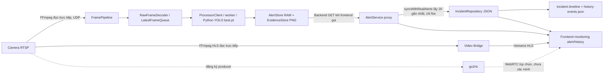

# FAVIS AI — kiểm tra luồng dữ liệu ngày 13/10/2026

## Bằng chứng trước khi sửa

- AI `/v1/pipeline/status`: camera `cam-test`, transport UDP, RUNNING; receivedFrames 7692 → 7891 → 8321; processedFrames 6298 → 6420. Frame RGB24 tải về có 1.382.400 byte, 640×720, hình camera đang quay bàn làm việc. Đây là inference đang chạy, không chỉ API health.
- `.env.ai.local`: nguồn trực tiếp `rtsp://192.168.1.8:554/onvif2`. Không đổi cấu hình hoặc thông tin đăng nhập trong đợt kiểm tra.
- AI history: 5 alert (1 fire, 4 smoke); evidence fire có hình ngọn lửa trên màn hình điện thoại với bounding box FIRE 56.1%. Không phải kiểm chứng cháy thật tại hiện trường.
- Bridge `/api/v1/cameras/cam-test/status`: CONNECTED, 31.214 frame, media sequence 2076, playlist mới 352 ms. go2rtc chỉ có đăng ký producer, chưa có consumers; không suy ra WebRTC hoạt động.
- Backend có 12 incident, 11 sourceAlertId khác nhau; 8 request đồng bộ song song không làm tăng số incident. Evidence: 1/11 trả PNG, 10/11 trả 404. URL evidence tương đối gọi qua frontend :3000 cũng trả 404 vì Vite `/api` trỏ bridge.
- Giả lập fetch bị lỗi trong bundle frontend: cameraService trả 24 camera mẫu, notificationService trả 3 notification mẫu, incidentService trả KPI 24/23/1 và OPERATIONAL. FAIL.
- Không tìm thấy log lưu trên đĩa cho lần CONNECTING/frames=0 trước đây. Không kết luận hồi cứu nguyên nhân chính xác. Code có explicit start, timeout NO_FRAMES_TIMEOUT và diagnostic RTSP; trạng thái hiện tại không tái hiện lỗi này.
- Có nhiều thay đổi sẵn trong working tree, gồm cả các view bị xóa. Giữ nguyên, không reset, checkout hoặc commit.

## Sơ đồ code hiện tại trước khi sửa

## File, function và endpoint

| Đoạn | Code/endpoint | Trạng thái ban đầu |
|---|---|---|
| Camera → AI | `config.cameraUrl`, `FramePipeline.start`, `extractionArgs`; `/v1/pipeline/status`, `/v1/frames/latest` | PASS trên camera hiện tại |
| Frame → inference | `RawFrameDecoder`, `LatestFrameQueue`, `ProcessorClient`, `YoloProcessor.inferFrame`; Python `model.predict` | PASS bằng bộ đếm tăng và frame/evidence |
| Inference → alert | `AlertStore.record/publish`, temporal filter, cooldown; `/v1/alerts`, `/v1/alerts/latest` | PASS cho alert hiện có; persistence FAIL theo thiết kế RAM |
| Alert → Backend | `AlertService.getAlertHistory/getLatestAlert` proxy AI | FAIL: chưa lưu alert nghiệp vụ, chưa có ingestion nền |
| Backend → Incident | `IncidentService.syncWithRealAlerts/createIncidentFromRealAlert`; `/api/v1/incidents` | PASS chống trùng ID cho request lặp hiện tại; FAIL cửa sổ chỉ 20 và phụ thuộc request |
| Timeline/history | Incident JSON, `IncidentRepository.addHistoryEvent`; `/api/v1/incidents/:id`, `/incidents/history` | PASS đọc dữ liệu hiện có; restart process chưa kiểm chứng |
| Evidence | AI `EvidenceStore`, Backend `fetchEvidence`, `/api/v1/evidence/:file` | FAIL: 10 evidence cũ 404; constructor AI xóa PNG cũ, proxy phụ thuộc AI history |
| Frontend | monitoringAlertService qua Backend; incidentService, notificationService, cameraService, siteService | FAIL: fallback giả và cập nhật offline giả; URL ảnh incident tương đối 404 |
| Video | Bridge `/api/v1/cameras/:id/status`, `/streams/:streamId/index.m3u8`; go2rtc `:1984` | Bridge nhận frame PASS; playback giải mã và WebRTC NOT VERIFIED |
| Camera config | cameraConnectionService localStorage merge/push, save hai đường Backend và Bridge | FAIL nguồn dữ liệu và xác nhận lưu: không kiểm tra kết quả, có thể ghi lại camera local-only |

`App.tsx` trước sửa chuyển `/incidents/*` sang `/monitoring`, nên view danh sách/chi tiết incident còn trong code nhưng không được mount. Đã mount lại các view hiện có tại `/incidents` và `/incidents/:id`, không đổi component hoặc giao diện.

## Nhóm sửa đã xác định

1. Giữ polling, bổ sung lưu alert/evidence Backend và ingestion nền; durable pending queue AI để restart hoặc vượt cửa sổ 20 không làm mất alert chưa tiếp nhận. Giữ model, threshold, temporal filter, cooldown và quy tắc chỉ fire tạo incident.
2. Chỉ đánh dấu đồng bộ sau khi lưu thành công; single flight; ID history xác định và backfill history nếu incident đã lưu mà history chưa lưu. Repository báo lỗi ghi thay vì giả thành công.
3. Frontend lấy dữ liệu nghiệp vụ Backend, bỏ mock/offline mutation âm thầm; camera config không tự merge/push localStorage, chỉ báo save thành công khi Backend xác nhận. Giữ draft/player session cục bộ. Dùng Backend URL cho ảnh incident.
4. Chạy test bằng thư mục dữ liệu tạm và process riêng; không restart AI hiện tại để tránh xóa evidence trước khi lưu trữ. Không sửa Authentication/Login hoặc UI routing.

## Kết quả sau sửa

- AI test: 34 passed, 1 skipped (skipped là integration model có điều kiện `AI_TEST_YOLO=1`); persistence test đạt.
- Video Bridge test: 8 passed; test HLS restart/discontinuity đạt sau khi test giữ boundary trong rolling playlist.
- Backend integration: 7 passed. Test dùng 125 alert, không tạo request Frontend để kích hoạt ingestion; tạo 124 incident fire, 124 history, không trùng sourceAlertId/code; đồng thời kiểm tra retry, đồng bộ song song, AI/Backend restart, outage và evidence.
- Frontend data contract: 4 passed. Khi Backend lỗi, các service reject và view hiển thị lỗi/trạng thái rỗng; không trả mock KPI, camera hoặc notification.
- Build/typecheck: `npm run lint`, `npx tsc -p backend/tsconfig.json --noEmit`, `npm run build` đều đạt.
- Runtime sau restart có kiểm chứng: AI `RUNNING`, camera `cam-test`, RTSP UDP, `receivedFrames` 1888, `processor.inferencePerformed=true`, `processedFrames` 1478; AI tạo 1 alert mới và Backend archive có 19 alert, pending queue = 0. Sau khi restart Backend, archive còn 19 alert, 12 incident, 26 history và evidence trả `200 image/png`. Đây là bằng chứng camera thật và YOLO inference đã chạy sau restart. Ảnh live/evidence đã được tải và kiểm tra bằng mắt; không kết luận nội dung đó là cháy thật.
- Trên lần kiểm tra cuối sau khi nạp bản sửa: AI `RUNNING`, `receivedFrames` 197, `processedFrames` 151, `inferencePerformed=true`, `pendingDeliveries=0`; Backend giữ 19 alert, 12 incident, 26 history; 19/19 evidence trả `200 image/png`; Bridge `CONNECTED`, playlist age 816 ms.
- Lỗi trạng thái sai đã sửa: reject khi model worker load nay gọi `fail('PROCESSOR_LOAD_FAILED')`, dừng child và không treo `CONNECTING`. Test hồi quy đạt; nguyên nhân cụ thể của lần lỗi cũ vẫn NOT VERIFIED vì không còn log lịch sử.
- Video Bridge runtime: HLS playlist và status `CONNECTED` đã kiểm tra trên camera; go2rtc producer có đăng ký nhưng WebRTC playback chưa chạy qua browser nên vẫn NOT VERIFIED.

PASS chỉ áp dụng cho hành vi đã thực thi; camera thật, inference model thật, API và browser UI được phân biệt rõ.
